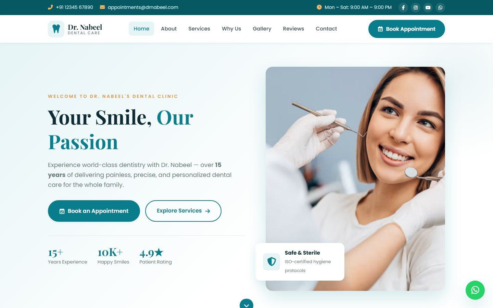
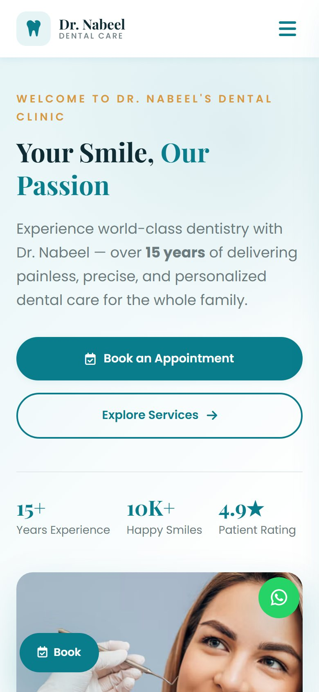
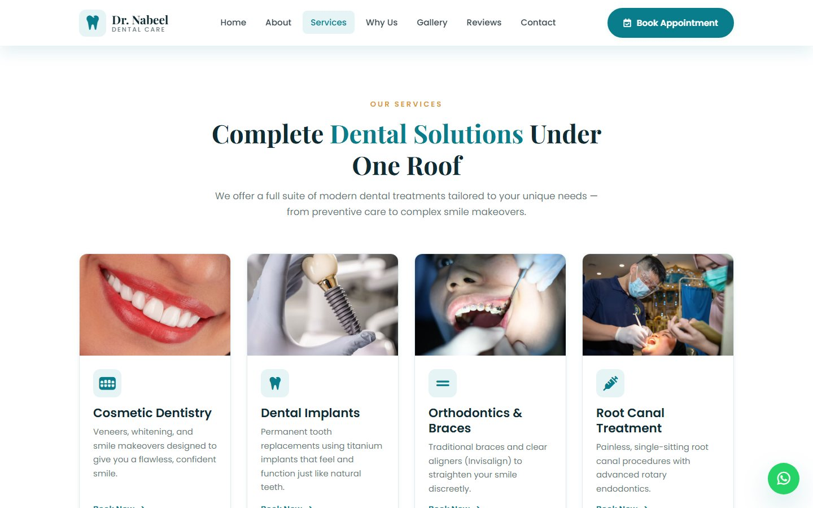
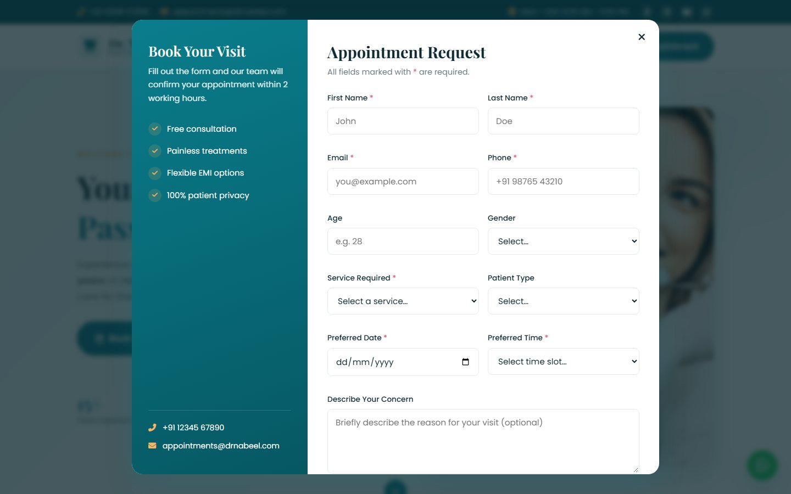

<div align="center">

# Dental Clinic Website Template

### A responsive dentist website built with plain HTML, CSS and JavaScript

A single-page website for a dental clinic, with services, a smile gallery, patient reviews and an appointment booking form. It has no framework and no build step, and it runs on GitHub Pages.

[**Live demo**](https://rummanhassan13.github.io/Dental-Clinic/) · [Features](#features) · [Screenshots](#screenshots) · [Customise it](#customise-it) · [Run locally](#run-locally)


</div>

<br>

<table>
  <tr>
    <td width="76%" valign="top"></td>
    <td width="24%" valign="top"></td>
  </tr>
  <tr>
    <td align="center"><sub>Desktop</sub></td>
    <td align="center"><sub>Mobile</sub></td>
  </tr>
</table>

> [!NOTE]
> This is a **concept and template**, not a live clinic. "Dr. Nabeel" is a sample brand. The phone number, address, email, ratings and reviews are placeholders, and the photos are from Unsplash. The booking form validates input but doesn't send it anywhere yet. See [Connect the booking form](#connect-the-booking-form).

## Features

<table>
  <tr>
    <th align="left" width="50%">Page sections</th>
    <th align="left" width="50%">Interaction and quality</th>
  </tr>
  <tr valign="top">
    <td>

- Top bar with phone, email, opening hours and social links
- Hero section with booking buttons and trust stats
- About the dentist, with qualifications
- 8 service cards: cosmetic dentistry, implants, braces, root canal, children's dentistry, whitening, gum treatment and oral surgery
- "Why choose us" grid
- Smile gallery and patient reviews
- Contact section with an embedded OpenStreetMap
- Footer, a floating WhatsApp button and a floating "Book" button

</td>
    <td>

- **Appointment booking modal** with live field validation, a future-date check, time slots, a consent checkbox and loading and success states
- **Accessible modal:** focus moves into the form, Escape closes it and focus returns to where you were
- **Mobile menu** with an overlay, a sticky header and smooth scrolling that allows for the header
- **Scroll spy** highlights the current section in the menu
- **Reveal-on-scroll animations** with `IntersectionObserver` that respect `prefers-reduced-motion`
- **Responsive layout** with CSS Grid and breakpoints at 992, 768 and 480 px
- **Themeable:** 19 CSS custom properties for colours, shadows, corner radius, container width and transitions
- Lazy-loaded images and descriptive alt text

</td>
  </tr>
</table>

## Screenshots

<table>
  <tr>
    <td width="50%" valign="top"></td>
    <td width="50%" valign="top"></td>
  </tr>
  <tr>
    <td align="center"><sub>Services</sub></td>
    <td align="center"><sub>Appointment booking form</sub></td>
  </tr>
</table>

## Tech stack

| | |
| :-- | :-- |
| **Markup** | Semantic HTML5 with ARIA labels on the modal, menu and icon buttons |
| **Styles** | CSS3 with custom properties, Grid, Flexbox and media queries. One stylesheet, no preprocessor |
| **Scripts** | Vanilla JavaScript in one file (~240 lines), no dependencies |
| **Fonts and icons** | Google Fonts (Poppins, Playfair Display) and Font Awesome 6 |
| **Hosting** | GitHub Pages |

## Run locally

There's no install or build step. Clone the repo and open `index.html`, or serve the folder:

```sh
git clone https://github.com/rummanhassan13/Dental-Clinic.git
cd Dental-Clinic
npx serve .
```

```text
Dental-Clinic/
├── index.html      All page sections and the booking modal
├── css/style.css   Theme variables, layout and responsive rules
└── js/script.js    Menu, scroll spy, reveal animations, modal and form validation
```

## Customise it

1. **Brand and content:** change the clinic name, the doctor's details, services and copy in `index.html`.
2. **Contact details:** replace the placeholder phone, email, address, the WhatsApp link (`wa.me/...`) and the map coordinates in the OpenStreetMap `iframe`.
3. **Colours:** edit the custom properties at the top of `css/style.css`. The brand colour is `#0a7d8c`, which is also used as `theme-color`.
4. **Images:** swap the Unsplash URLs for the clinic's own photos, and keep the alt text descriptive.
5. **Reviews and stats:** replace the sample reviews and numbers with real, verifiable ones before you publish.

### Connect the booking form

In `js/script.js`, the submit handler validates the form and then simulates sending it with `console.log`. Replace that block with a real request, for example to Formspree, a serverless function or a clinic CRM:

```js
const data = Object.fromEntries(new FormData(form).entries());
await fetch("https://formspree.io/f/your-form-id", {
  method: "POST",
  headers: { "Content-Type": "application/json", Accept: "application/json" },
  body: JSON.stringify(data),
});
```

## Status

A finished concept that's live on GitHub Pages. No license has been specified yet, so all rights are reserved by the author.

## About the author

This dental clinic website template is designed and built by **[Rumman Hassan](https://rummanhassan.cv)**, a full-stack developer in Lahore, Pakistan. Rumman builds websites, web apps, ecommerce stores and AI systems for growing businesses, including clinics and local service brands.

Need a website like this for your practice? [Book a call](https://cal.com/rummanbuilds/connect) or visit [rummanhassan.cv](https://rummanhassan.cv).

[Website](https://rummanhassan.cv) · [GitHub](https://github.com/rummanhassan13) · [LinkedIn](https://www.linkedin.com/in/rummanhassan13)
